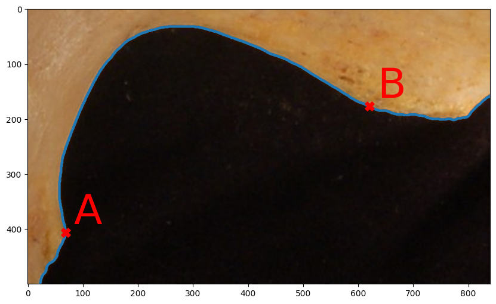
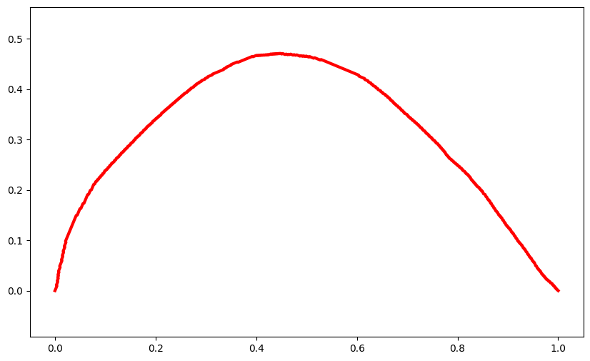

# gsn_segment

is a project to predict biological sex from the greater sciatic notch (GSN) shape from 2D images. The GSN shape is represented with elliptic Fourier coefficients. The predictor is an SVM (support vector machines) model trained on 391 samples from 4 populations: North America (USA and Mexico), Europe (Switzerland), and Asia (Thailand).
Corresponding research paper: [https://doi.org/10.1007/s00414-026-04075-7](https://link.springer.com/article/10.1007/s00414-026-04075-7).

## Installation

Install version control system [Git](https://git-scm.com/), package management tool [Pixi](https://pixi.prefix.dev/latest/installation/), and an IDE such as [Pycharm](https://www.jetbrains.com/pycharm/download) or [Visual Studio Code](https://code.visualstudio.com/Download)). From your IDE, clone the project: `https://github.com/anna-grishko/gsn_segment.git`.

To generate PDF reports, [Quarto](https://quarto.org/) must also be installed.

## Environment setup

Dependencies—including the required Python interpreter—are managed automatically by `pixi`. From the repository root, build the default environment and install project dependencies by running the next command in the Terminal:

```bash
pixi install
```

And run the application for the sex estimation:

```bash
pixi run application
```

## Introduction
The pelvic bone is the most reliable indicator of sex on the human skeleton, but some of its parts are more susceptible to taphonomic damage. Conversely, the greater sciatic notch (GSN) belongs to the morphological structures of this bone that are very well preserved, and it also exhibits a high degree of sexual dimorphism. With advanced methods such as geometric morphometrics (GMM) and machine learning (ML), outlines of the GSN can be quantified and analyzed. 
The proposed automated workflow provides a reliable, objective, and population-independent tool for biological profiling, particularly valuable in forensic contexts where the geographic origin of the remains is unknown.

## Workflow

1) Run the application
2) Select a folder with your images of the GSN; select a folder where the results will be stored
3) Press Start Batch Process
4) Crop your images so the GSN is well-visible
5) Place landmarks in the correct order: the piriformis tubercle (A) and then the base of the spina ischiadica (B)
6) Results will be saved to the selected folder

<p align="center">
  
</p> 

<p align="center">
  
</p> 


## License

[Apache License 2.0](https://choosealicense.com/licenses/apache-2.0/)
