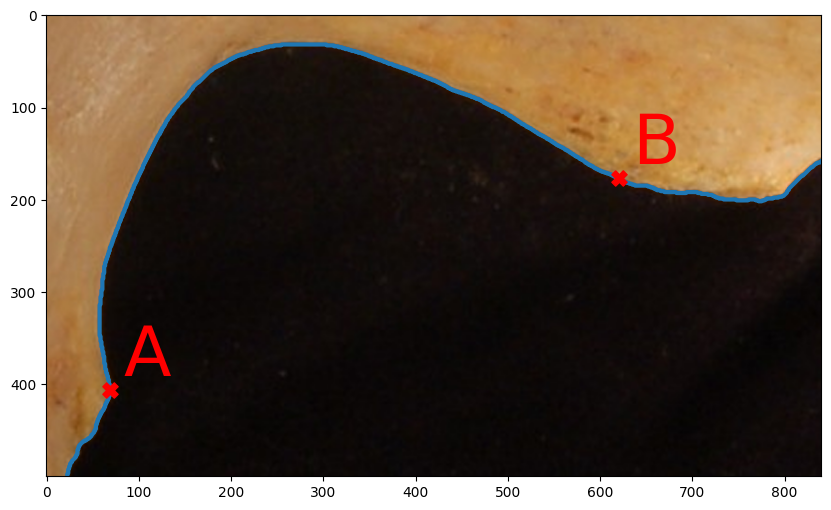
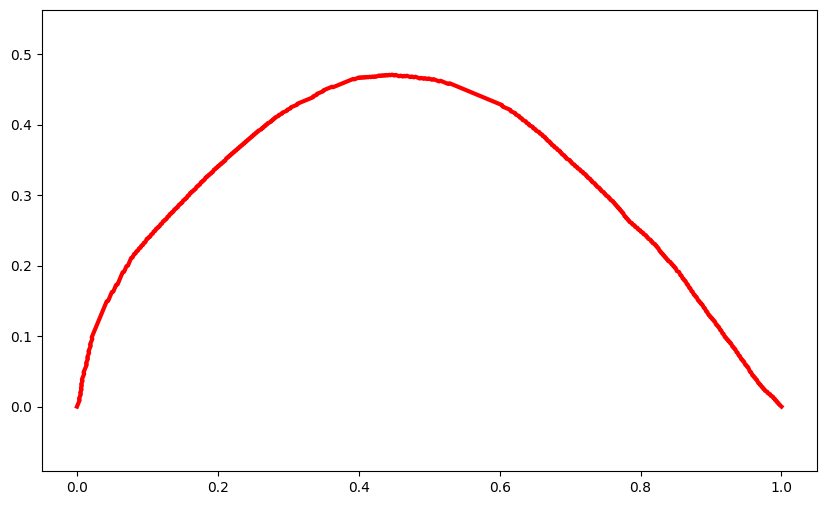

# gsn_segment

is a project to predict biological sex from the greater sciatic notch (GSN) from 2D images.

## Installation

You should have [Python](https://www.python.org/downloads/) installed (you might consider [Conda](https://docs.conda.io/projects/conda/en/latest/index.html) distribution instead) and IDE ([Pycharm](https://www.jetbrains.com/pycharm/download/?section=windows) or [Visual Studio](https://code.visualstudio.com/Download)). From your IDE clone the project: [https://github.com/anna-grishko/gsn_segment.git](https://github.com/anna-grishko/gsn_segment.git)


## Environment setup

Dependencies and environments are managed with [pixi](https://pixi.prefix.dev/).

Install pixi once (see the [installation guide](https://pixi.prefix.dev/latest/installation/)).

Then from a repository root build the default environment and install project dependencies:

```bash
pixi install
```

And run the application for thr sex estimation:

```bash
pixi run start
```

## Introduction
The pelvic bone is the most reliable indicator of sex on the human skeleton, but some of its parts are more susceptible to taphonomic damage. Conversely, the greater sciatic notch (GSN) belongs to the morphological structures of this bone that are very well preserved, and it also exhibits a high degree of sexual dimorphism. With advanced methods such as geometric morphometrics (GMM) and machine learning (ML), outlines of the GSN can be quantified and analyzed. 
The proposed automated workflow provides a reliable, objective, and population-independent tool for biological profiling, particularly valuable in forensic contexts where the geographic origin of the remains is unknown.

## Workflow

1) Run the application
2) Select a folder with your images of the GSN; select a folder where the results will be stored
3) Press Start Batch Process
4) Crop your images so the GSN is well-visible
5) Place landmarks in the correct order: the piriformis tubercle (A) and then the base of the spina ischiadica (B).
6) Results will be saved to the selected folder

<p align="center">
  
</p> 

<p align="center">
  
</p> 


## License

[Apache License 2.0](https://choosealicense.com/licenses/apache-2.0/)
