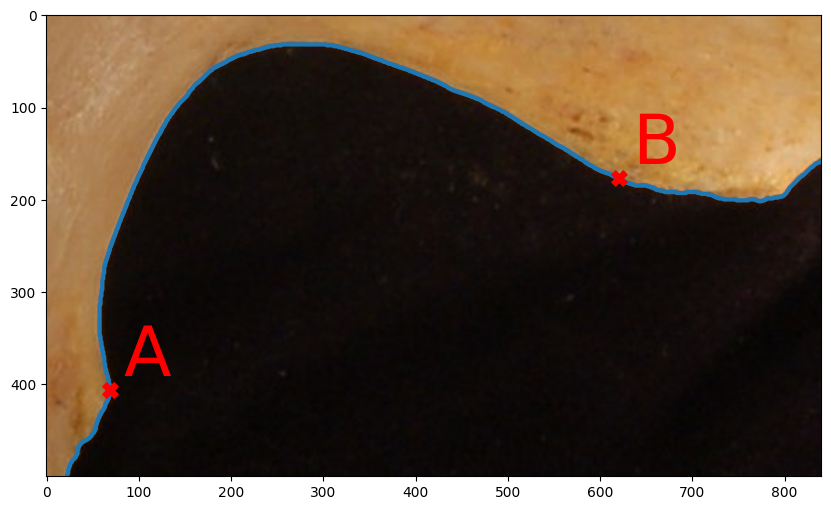
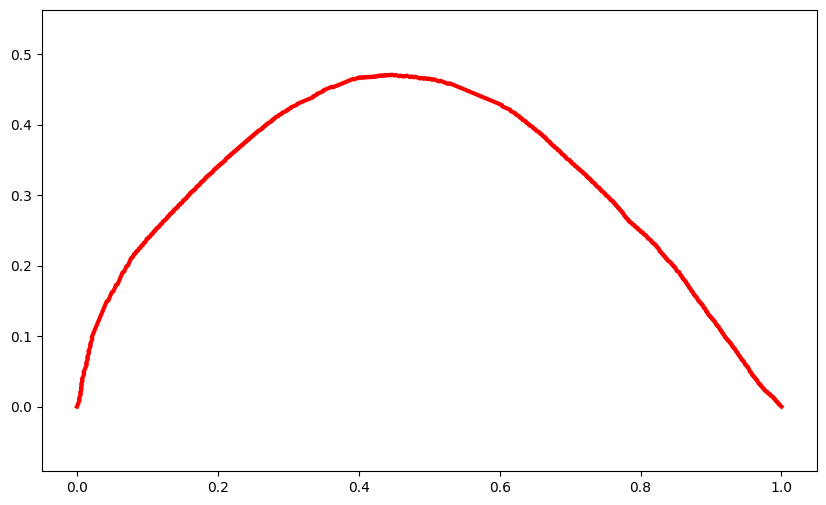

# gsn_segment

is a project to predict biological sex from the greater sciatic notch (GSN) from 2D images.

## Installation

Use the package manager [pip](https://pip.pypa.io/en/stable/) to install abc.

```bash
pip install abc
```

## Introduction
The pelvic bone is the most reliable indicator of sex on the human skeleton, but some of its parts are more susceptible to taphonomic damage. Conversely, the greater sciatic notch (GSN) belongs to the morphological structures of this bone that are very well preserved, and it also exhibits a high degree of sexual dimorphism. With advanced methods such as geometric morphometrics (GMM) and machine learning (ML), outlines of the GSN can be quantified and analyzed. 
The proposed automated workflow provides a reliable, objective, and population-independent tool for biological profiling, particularly valuable in forensic contexts where the geographic origin of the remains is unknown.

## Workflow

1) Run the main.py file
2) Select a folder with your images of the GSN; select a folder where the results will be stored
3) Press Start Batch Process
4) Crop your images so the GSN is well-visible
5) Place landmarks in the correct order: the piriformis tubercle and then the base of the spina ischiadica.
6) Results will be saved to the selected folder

<p align="center">
  
</p> 

<p align="center">
  
</p> 


## License

[Apache License 2.0](https://choosealicense.com/licenses/apache-2.0/)